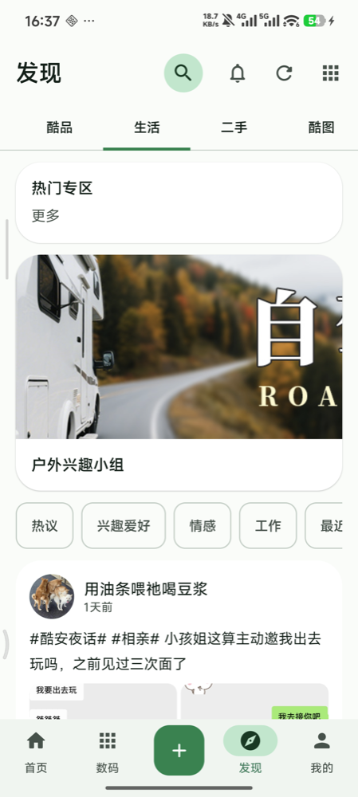
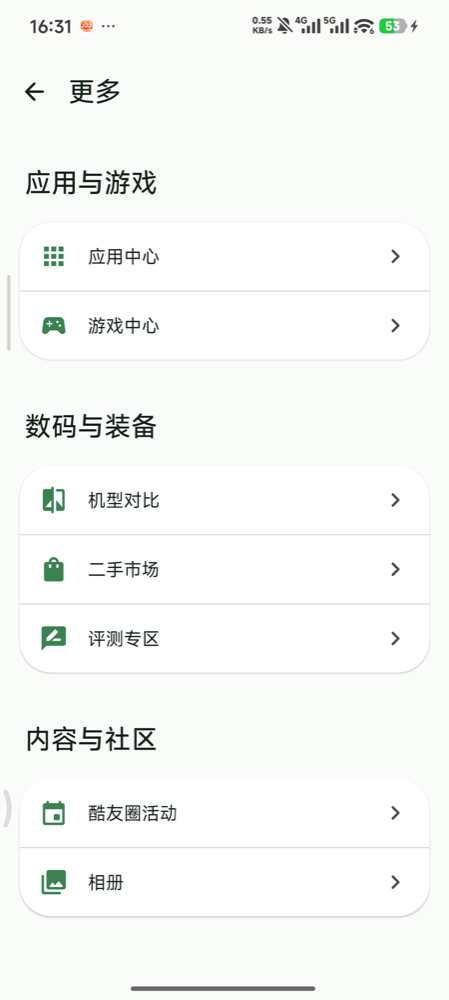
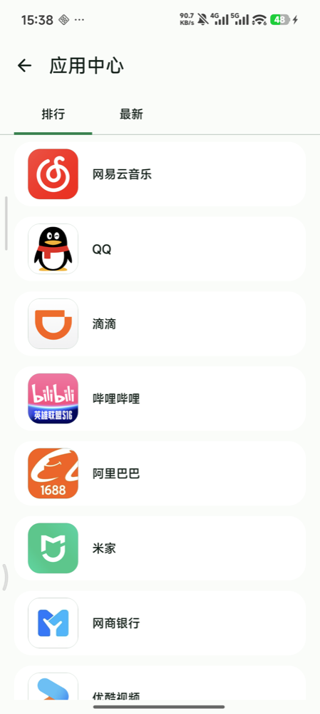
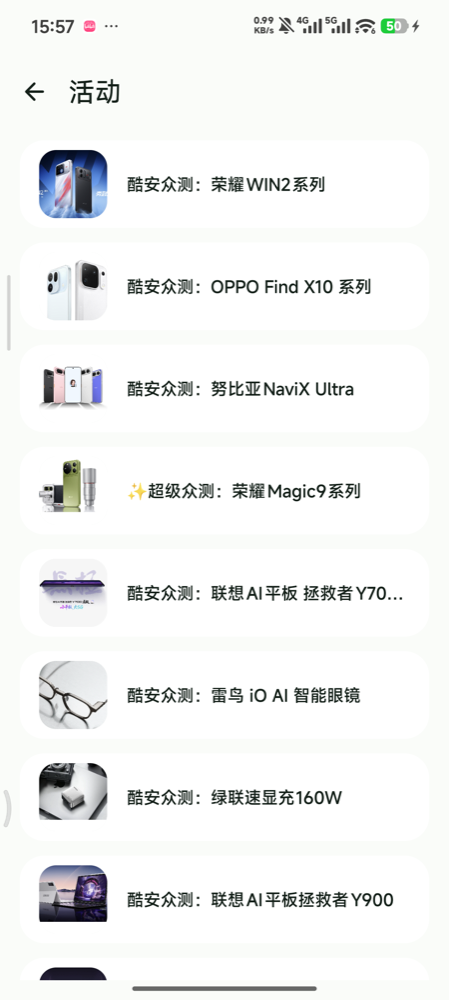

# Coolapk KMP

非官方酷安客户端实验工程。Android 使用 Jetpack Compose，以 Coolapk green 和 Material 3 Expressive 为视觉方向；iOS 使用原生 SwiftUI 和绿色主题。两端复用 Rust API 核心，但目前只有 Android 通过 KMP Gateway 接入，iOS 直接调用 UniFFI Swift 绑定。

> 本项目不包含或分发酷安官方 Logo、商标素材及私有签名材料。请遵守目标服务条款并仅用于学习研究。

## 当前功能

- 两端主界面均为首页、数码、发布、发现、我的（iOS 标签名为“我”）五个入口。Android 窄屏使用底部导航，宽屏使用侧边导航；配色以 Coolapk green 为主，Android 采用 Material 3 Expressive 控件风格。
- 首页提供动态列表、刷新和分页；动态详情可阅读评论、切换排序、只看楼主和查看楼中楼，从评论按钮进入时定位评论区。iOS 进入详情后会请求完整动态；请求失败（包括游客遇到验证码）时保留列表内容作为预览，评论仍可查看。两端均接入动态点赞和直接发表评论；Android 还接入评论点赞与回复评论。这些互动需要有效会话。
- 数码入口读取服务端栏目，展示数码内容和按品牌/分类浏览的产品列表；可进入产品详情。Android 详情呈现图片、品牌/分类、评分、热度、介绍及规格等已解析字段，并适配宽屏；iOS 详情呈现图片、规格及价格、评分、上市等已解析字段。服务端数据和卡片类型并非全部适配。
- 发布入口支持不带媒体的纯文本动态、编辑/预览和按账号保存与恢复草稿。发布需要登录，验证码或风控仍可能阻止请求；图片、视频等媒体发布尚未实现。
- 搜索支持综合、应用、游戏、用户、动态、问答、数码、话题八类结果及分页，并显示热词。可打开已接入的动态、应用和数码产品详情；用户、话题等结果目前仅展示，不提供完整详情页。
- 发现入口读取服务端栏目和卡片。Android 支持服务端筛选项、栏目独立缓存与滚动位置恢复；两端可打开已支持的站内内容或网页。图片查看器支持从已接入的动态、应用/产品图片等入口打开。通知提供未读数和五类只读列表，可从带动态目标的通知进入详情。
- 两端提供酷安官方网页登录，可自动读取登录 WebView 会话并校验；手动 Cookie 导入仍可备用。Android 使用 Keystore AES-GCM 保存会话，iOS 使用 Keychain。应用列表和热榜相关接口/页面代码仍在工程中，但不属于当前五个主入口；应用可从搜索或相关卡片进入详情。

这些能力表示代码已接入，不代表已经完成所有设备、账号和服务端响应的验收。详见 [功能矩阵](docs/feature-matrix.md) 和 [架构说明](docs/architecture.md)。

## 界面预览

<p align="center">
  
  
  
  
  
</p>

## 模块

- `androidApp/`：Compose 页面、导航和 Android 平台交互。
- `iosApp/`：SwiftUI 客户端及 UniFFI Swift 绑定；不经过 KMP iOS Gateway。
- `shared/`：KMP 领域模型、解析器、Repository 与 Gateway；`iosMain` Gateway 仍为占位实现。
- `rust-core/`：从 `coolapk-desktop` 提取的 API 核心与 UniFFI 边界。
- `scripts/`：Android 原生库构建、UniFFI 绑定生成及 iOS XCFramework 构建脚本。

## 构建与检查

Android 目前只提供 `arm64-v8a` 原生库构建脚本。配置 Android SDK/NDK 和 Rust Android target 后，从仓库根目录执行：

```bash
./scripts/build-rust-android.sh
./gradlew :shared:allTests :androidApp:testDebugUnitTest :androidApp:assembleDebug
cargo test --manifest-path rust-core/Cargo.toml --all-targets
```

iOS 需要 Xcode、XcodeGen 及 `aarch64-apple-ios-sim`、`aarch64-apple-ios` Rust targets。构建脚本生成 Swift 绑定、模拟器/设备静态库、XCFramework 和 Xcode 工程；具体命令见 [iOS 构建说明](iosApp/README.md)。Android 单元测试和 Debug 构建已通过，并在 Pixel 9 Pro XL 模拟器确认官方登录页加载、取消后保留游客态；iOS arm64 模拟器构建通过，官方登录页也已显示。两端都未使用真实账号验收本次网页登录的授权回跳、验证码与登录后会话，发布和互动也未做真实账号验证。
